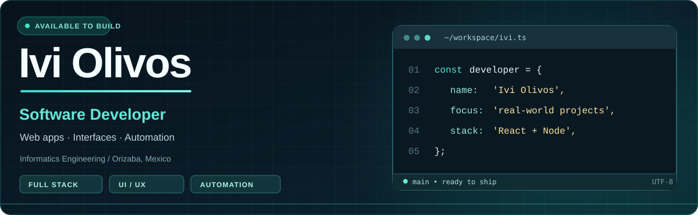

<!-- Profile README · Ivi Olivos -->
<p align="center">
  
</p>

<p align="center">
  <a href="https://github.com/IviOlivos18?tab=repositories"></a>
  <a href="mailto:olivosivi@gmail.com"></a>
  
</p>

<p align="center">
  <b>Transformo ideas en experiencias digitales útiles, intuitivas y bien construidas.</b><br/>
  <i>Turning ideas into useful, thoughtful digital experiences.</i>
</p>

---

### 👨🏻‍💻 Sobre mí

¡Hola! Soy **Ivi**, estudiante de **Ingeniería Informática en el Tecnológico de Orizaba**. Me gusta construir productos de software de principio a fin: pensar la experiencia de usuario, desarrollar interfaces, conectar servicios y automatizar procesos.

- 🚀 **Lo que me mueve:** desarrollo web, inteligencia artificial aplicada y soluciones que resuelvan problemas reales.
- 🧩 **Cómo trabajo:** mezclo lógica, diseño y aprendizaje continuo; disfruto tanto programar como cuidar los detalles de la interfaz.
- 🔐 **Áreas que exploro:** ciberseguridad, automatización y experiencias digitales accesibles.
- 🤝 **Busco:** colaborar en proyectos interesantes y crecer profesionalmente dentro de equipos de desarrollo.

### 🛠️ Tecnologías y herramientas

<p align="center">
  
</p>

<p align="center">
  <sub><b>Desarrollo:</b> React · Next.js · Node.js · Python · TypeScript &nbsp; | &nbsp; <b>Diseño y herramientas:</b> Figma · Git · Firebase · AWS</sub>
</p>

### ✨ Proyectos que cuentan mi historia

<table>
  <tr>
    <td width="50%" valign="top">
      <h3>🌱 <a href="https://github.com/IviOlivos18/ecoseeds">EcoSeeds</a></h3>
      <p>Plataforma web enfocada en donaciones e iniciativas ambientales, con una experiencia interactiva y un chatbot de apoyo.</p>
      <p><code>Next.js</code> <code>TypeScript</code> <code>CSS Modules</code></p>
      <a href="https://github.com/IviOlivos18/ecoseeds">Ver repositorio ↗</a>
    </td>
    <td width="50%" valign="top">
      <h3>📦 Mi Inventario BW</h3>
      <p>Proyecto de gestión de inventario para registrar movimientos de productos, consultar existencias y automatizar tareas operativas.</p>
      <p><code>Inventarios</code> <code>Automatización</code> <code>Web</code></p>
      <sub>Proyecto en desarrollo · código no público</sub>
    </td>
  </tr>
  </table>

### 📊 GitHub, en números

<p align="center">
  
</p>

<p align="center">
  
  
</p>

<p align="center">
  
  
</p>

<p align="center"><sub>Gráficas dinámicas basadas en la actividad pública de GitHub. Los porcentajes de lenguajes reflejan el código de los repositorios, no el nivel de dominio.</sub></p>

### 🎯 En qué estoy enfocado

```ts
const ivi = {
  learning: ["Inteligencia artificial", "Ciberseguridad", "Arquitectura de software"],
  building: ["Aplicaciones web", "Automatizaciones", "Productos útiles"],
  mindset: "Aprender, construir, mejorar y compartir."
};
```

### 📬 ¿Construimos algo juntos?

Me interesan las oportunidades en **desarrollo de software**, los proyectos con propósito y las colaboraciones donde pueda aportar tanto código como ideas de producto.

<p align="center">
  <a href="mailto:olivosivi@gmail.com"></a>
  <a href="https://github.com/IviOlivos18"></a>
</p>

<p align="center"><i>"No solo escribir código; crear soluciones que valga la pena usar."</i> ✦</p>
