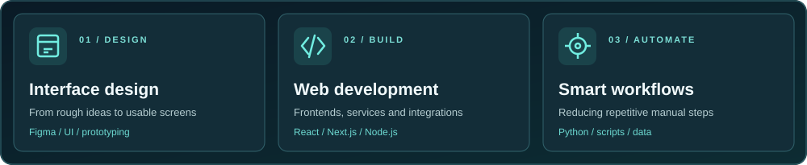
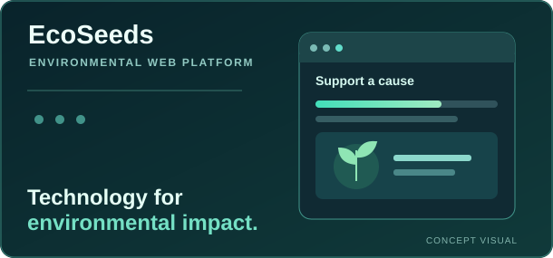
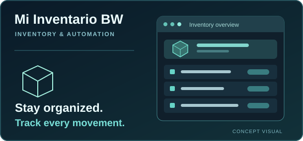
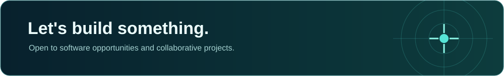

<!-- Ivi Olivos · GitHub profile -->

  

  
  &nbsp;
  

  Based in Orizaba, Veracruz, Mexico &nbsp; · &nbsp; Building for the web

---

<h2> &nbsp; About me</h2>

I'm **Ivi**, an Informatics Engineering student at **Tecnológico de Orizaba**.

I enjoy both sides of building a product: sketching the interface and making the code actually work. I spend most of my time on web development, design tools, and automations that make everyday tasks easier.

  

<h2> &nbsp; Tools & technologies</h2>

  

  
  
  

<h2> &nbsp; Selected work</h2>

<table>
  <tr>
    <td width="50%" valign="top">
      
      <h3><a href="https://github.com/IviOlivos18/ecoseeds">EcoSeeds</a></h3>
      
A web platform for environmental initiatives and donations, with an interactive UI and chatbot.

      
<code>Next.js</code> <code>TypeScript</code> <code>CSS Modules</code>

      <a href="https://github.com/IviOlivos18/ecoseeds">View source code</a>
    </td>
    <td width="50%" valign="top">
      
      <h3>Mi Inventario BW</h3>
      
Inventory management and process automation, designed to keep product records and stock movements organized.

      
<code>Inventory</code> <code>Automation</code> <code>Web</code>

      Private project · In development
    </td>
  </tr>
</table>

Project visuals are custom illustrations, not application screenshots.

<h2> &nbsp; GitHub activity</h2>

  

Contribution count shown as a snapshot. It is not a live counter.

<h2> &nbsp; Let's connect</h2>

  

  
  &nbsp;
  

