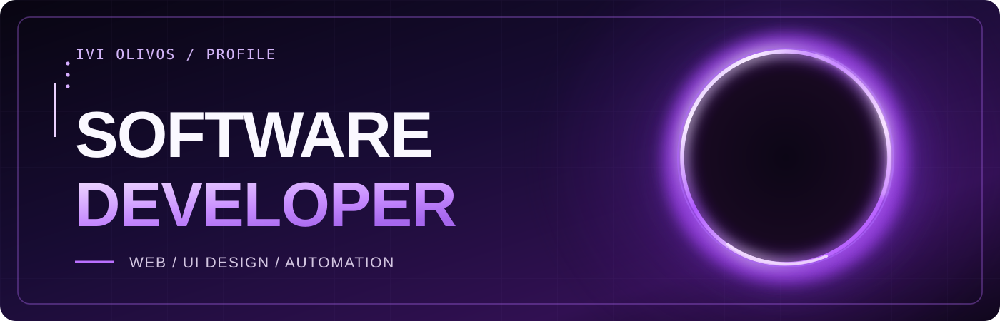
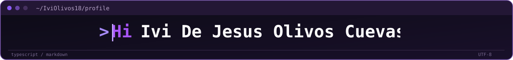
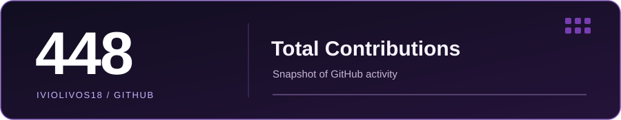

<!-- Ivi De Jesus Olivos Cuevas / GitHub profile README -->

  

  

  <strong>Software Developer · Informatics Engineering student</strong>

  
  &nbsp;
  
  &nbsp;
  

### 👨‍💻 About me

I'm **Ivi**, an Informatics Engineering student at the **Tecnológico de Orizaba** in Mexico.

I like building things that people can actually use. Most of my time goes into **web applications, interface design, backend integrations, and automation**. I enjoy turning an early idea into a working product — and improving it until every part feels right.

**Right now:** developing software projects, exploring artificial intelligence and cybersecurity, and getting more experience working across the full stack.

  
  
  

### 🛠️ Languages & technologies

<strong>Programming & Web</strong>

  

<strong>Databases, Data Science & AI</strong>

  

<strong>Development tools & platforms</strong>

  

  
  
  
  

### ✨ Featured projects

<table>
  <tr>
    <td width="50%" valign="top">
      

        
      

      <h3><a href="https://github.com/IviOlivos18/ecoseeds">EcoSeeds</a></h3>
      
Web platform for supporting environmental initiatives through donations, with an interactive interface and chatbot.

      
<code>Next.js</code> <code>TypeScript</code> <code>CSS Modules</code>

      <a href="https://github.com/IviOlivos18/ecoseeds">Explore repository</a>
    </td>
    <td width="50%" valign="top">
      

        
      

      <h3>Mi Inventario BW</h3>
      
Inventory software for managing product records, stock movements and workflow automation.

      
<code>Inventory</code> <code>Automation</code> <code>Web</code>

      Private project · In development
    </td>
  </tr>
</table>

### 📊 GitHub activity

  

A snapshot of 448 contributions, not a live counter.

  

Daily contribution calendar in violet · dynamically generated from public GitHub activity.

### 🤝 Connect with me

I'm interested in software development opportunities, building useful products and collaborating with other developers.

  
  &nbsp;
  

  

  

